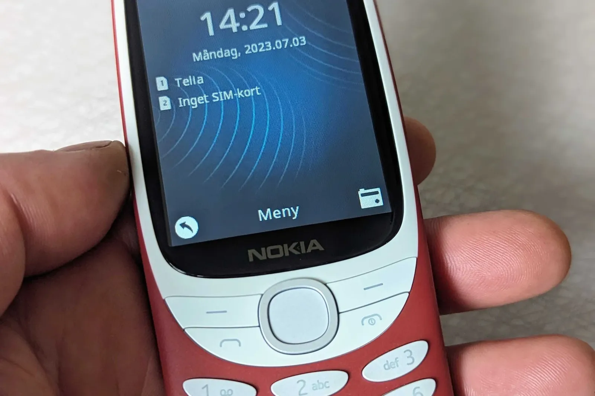

Allt oftare har jag ställt mig frågande till om min relation till min telefon verkligen ger mig ett mervärde, alltså själsligt ökar min livskvalitet. Därför har jag testat att leva utan en smartphone i nio månader. I stället har jag använt en Nokia, en sån där utan touchdisplay och med riktiga knappar.

Det har bitvis varit en utmaning. Ibland har det varit rentav omöjligt, men oftast bara väldigt krångligt. Trots det har jag upplevt en del positiva förändringar av mina vanor, mina sociala relationer och min tankevärld.

## Avtändningen

De inledande veckorna var hemska. Att inte ha sin smartphone var väldigt likt att sluta snusa. Fingrarna trevade konstant mot byxfickan i en tvångsmässig jakt på tröst. Jag kände mig både tom och rastlös, en känsla som är svår att inte associera till en beroendeproblematik.

Men det klingade faktiskt av efter några veckor, som med de flesta artificiella behov och beroenden. Därmed inte sagt att det var en behaglig omställning.

## Tillfällen då jag gett upp

För att inte ge läsaren en falsk bild vill jag redan nu erkänna att jag behövt fuska ibland. Efter bara några veckor insåg jag att det är praktiskt omöjligt att vara helt utan en smartphone. Ett datasim införskaffades till min smartphone för akuta behov. Den har behövt användas till följande:

- Betalning
- Identifiering
- Navigering

Lite av ett platt fall för ett ambitiöst experiment, kan tyckas. Men användandet av min smartphone har trots allt reducerats med sisådär 90–95 procent, och jag har upplevt ganska stora förändringar i vardagen.

## Saker som varit mycket krångligare

Många saker blir helt enkelt väldigt bökiga utan en smartphone. Det blir uppenbart att mycket i samhället är utformat utifrån ett antagande att alla medborgare har en modern telefon.

### Betalning

Att betala utan en smartphone visade sig vara lite av ett helvete faktiskt. Låt mig ge några exempel.

**Hur parkerar man?**

Problem uppstod redan första dagen, när jag skjutsade barnen till badhuset. Hur betalar man parkering utan en smartphone och ett (orimligt) antal parkeringsappar? Möjligtvis fanns det en betalautomat någonstans, men inte inom synhåll – och definitivt inte möjlig att hitta inom rimlig tidsrymd med ett gäng badsugna ungar i baksätet. Jag lyckades faktiskt inte utan fick chansa en fulparkering den gången.

**Hur ger man pengar till någon?**

Swish är en fantastisk tjänst som förenklar mycket i vardagen. Framförallt för någon som mig som har en närmast panisk aversion mot att stå i skuld.

För att inte tala om alla stackars barn som knackar på för att sälja bambustrumpor, handstöpta ljus, salamikorvar, parmesanostar och gud vet vad. Inte kan man väl neka en stackars skolklass eller ett litet fotbollslag att övernatta i en svettig gympasal i Västerås, eller vad de nu ska göra med de insamlade slantarna. Detta har varit ett av fallen då jag faktiskt tvingats falla till föga och använda min smartphone.

**Hur vet jag att jag har pengar?**

Jag har för vana att ha en relativt begränsad mängd pengar på det konto som är kopplat till mitt betalkort. Och utan en smartphone kunde jag inte kolla saldot lika smidigt som tidigare. Vad jag vet finns möjligheten fortfarande att ringa sin bank och få saldot uppläst, så det går nog att kringgå. Men jag har helt enkelt hållit en överslagsräkning på månadens utlägg i minnet. Förmodligen har det gjort mig lite mer snål.

Då och då har oron att inte vara kontant ändå krupit på i matbutiken, på restauranger och vid tankstationen. Och det har varit en ganska obehaglig upplevelse. Den sociala skammen i att offentligt inte ha pengar på kortet är givetvis förkrossande.

### Identifiering

Mobilt Bank-ID har i ärlighetens namn varit väldigt svårt att klara vardagen utan. Andra tjänster för betalningar, försäkringar, skatter, vårdkontakter och kollektiva resor förutsätter ju också Bank-ID för att fungera någorlunda smidigt. Stockholms skolplattform, som omöjligen kan besökas utan någon form av digitalt id, har visserligen varit en befrielse att besöka så sällan som möjligt.

Här hade jag valet att beställa en speciell kortläsare för Bank-ID, eller att helt enkelt fortsätta använda mobilt Bank-ID när nöden krävde. Jag valde det senare, av ren lathet.

### Resor

Jag har ett närmast osannolikt dåligt lokalsinne. Så till den milda grad att jag kan köra eller promenera samma sträcka 10 gånger utan att hitta samma väg den 11:e gången. Min bil har dessutom ingen egen gps, utan där förväntas jag plugga in en smartphone för att åtnjuta frukterna av denna fantastiska uppfinning.

Min sambo har å andra sidan ett osannolikt gott lokalsinne, varför jag oftast förlitat mig på den navigeringshjälpen. Förvisso med baksidan att hon har en närmast osannolik oförmåga att skilja på höger och vänster. En oväntad bieffekt har faktiskt varit att barnen numer är mer engagerade när jag skjutsar dem och (med viss anad oro) hjälper till att hålla koll på var vi är och vart vi ska.

När jag rest längre sträckor själv har jag faktiskt fuskat och pluggat in gps:en. Annars hade jag förmodligen fortfarande varit på resande fot och inte kunnat skriva den här texten.

Kollektiva resor har däremot varit helt oproblematiska. Mitt vanliga bankkort fungerar utmärkt att blippa i spärren.

### Kommunikation

Digital kommunikation utan en smartphone har verkligen inneburit en social frånkoppling, några exempel:

**sms**

Den Nokia jag nu använder har förvisso en viss smartness genom sin prediktiva textinmatning, T9. Men upplevelsen är långt ifrån angenäm. Trögheten i att få till ett begripligt meddelande gjorde mig betydligt mer kortfattad (och felstavad). Andra spännande effekter:

- emojis kan inte tolkas, de visas bara som [] [] []. Men oftast går det förvånansvärt bra att gissa vad andra försöker uttrycka utifrån kontexten av den dialog som sker.
- MMS och bilder fyller minnet snabbt, eftersom de lagras på simkortet. 4–5 bilder, sen är det dags att börja radera meddelanden för att få plats med nya.
- Länkar i sms är inte ens lönt att försöka öppna. Den lilla Opera Mini-webbläsaren visar inget av relevans i 99 fall av 100.

**Meddelandeappar**

Privat sker såklart mycket av kommunikationen med olika grupperingar via appar som WhatsApp och Signal. Som de flesta andra föräldrar är jag inbjuden till chatgrupper för fotbollsträningar, klassresor, salamiförsäljningar och fan vet vad. Utöver det finns trådar för olika vänskapskluster och släktgrupperingar. En del intressanta saker har jag säkert missat, men det verkar som att essensen ändå når fram till slut via fysiska möten eller telefonsamtal.

I arbetslivet använder jag primärt Slack och Teams för digital kommunikation. Dessa kanaler har gått alldeles utmärkt att hantera med datorn under vanlig kontorstid. Jag har inte heller fått några signaler på att jag uppfattats som mer frånvarande eller sen att svara än vanligt.

**Sociala medier**

Att inte ha åtkomst till sociala medier är givetvis en stor förändring, men ingen direkt förlust. Sociala medier är väldesignade populärkulturella opiater. Och jag sugs lätt in i de beroendeframkallande flödena, precis som alla andra. Jag har inte saknat det, alls.

## Saker som varit lite mer behagliga

Utöver de frustrerande praktikaliteterna, där livet utan smartphone gör allt lite bökigare, har jag upplevt ett flertal fenomen i vardagen som faktiskt ökat min livskvalitet.

Några exempel:

- Mer tid
- Intressantare människor
- Intressantare tankar

### Mer tid

**Tidsvinster**

Uppskattningsvis har jag frigjort 1–2 timmar per dag genom att inte ha min smartphone tillgänglig. Det är tid som jag kunnat göra vad jag vill med. Därmed inte sagt att jag alltid utnyttjat den tiden till att utföra något fantastiskt produktivt. Men tidsvinsten har nog skänkt mig en lite mer rofylld vardag.

Min TV-tid har sannolikt ökat en del, men marginellt. Jag prenumererar inte på några streamingkanaler, eftersom innehållet där helt enkelt inte roar mig särskilt mycket. De kanaler jag har tillgång till är SVT1, SVT2, Kunskapskanalen och TV4. Då blir “binge-watching” snabbt outhärdligt, och den röda knappen på fjärrkontrollen blir ganska snart frestande.

**Väntande**

Jag har väntat mer. Alla de där små situationerna i vardagen när jag väntat på någon eller något, eller när jag rest kollektivt. De stunderna har jag tidigare plockat fram mobilen för att få tiden att gå lite fortare. Det gick inte att fly dessa situationer lika lätt.

Till en början var det både irriterande och frustrerande. Men allt mer började det kännas som något värdefullt. 10 minuter här och 5 minuter där blir till slut ganska många timmar på ett år med frihet att tänka på vad du vill eller observera vad som händer och sker runt omkring dig.

**Telefonsamtal**

Tidigare hände det ofta att jag inte svarade på telefonsamtal för att jag inte hade tid, eller för att jag helt enkelt inte orkade. Men med gammeltelefonen blev jag till och med glad och förväntansfull när det plingade i telefonen, för jag förväntade mig något relevant och personligt.

**Laddning**

Min Nokia är fantastisk! Jag behövde bara ladda den 2–3 gånger per månad för att vara ständigt tillgänglig. Från att dagligen ha letat och svurit över den förlagda laddaren fann jag nu en ro och ett lugn djupt in i själen. Det känns nästan lite förnedrande att jag ställt upp på det eviga laddandet under alla dessa år med smartphone.

### Intressantare människor

Saker andra berättade för mig blev mer intressanta, kanske för att de oftare hade något att berätta som jag inte redan kände till. Eftersom jag inte redan hade läst samma löpsedlar blev jag mer uppmärksam på personen framför mig och vad den hade att berätta.

Och eftersom jag inte heller tagit del av tillhörande debattartiklar, krönikor och kommentarstrådar kände jag oftast inte heller till den kollektivt redan överenskomna ståndpunkten till nyheten. Jag vill tro att det bidrog till mindre socialt torrsim, och fler meningsfulla samtal.

**Utanförskap**

Visserligen tittade jag på Aktuellt en del kvällar. Så jag har inte varit helt frånkopplad från samhällsagendan. Men ändå, en viss distans till det hela uppstod nog. En sund distans, tror jag.

Då och då har jag befunnit mig i sammanhang där jag är den enda i rummet – eftersom alla andra sitter med näbben i sina telefoner. En situation som givetvis skapar en känsla av utanförskap och visst obehag. Men det har också gjort mig mer uppmärksam på fenomenet, och på att jag bör undvika dessa situationer.

### Intressantare tankar

Genom lite introspektion kan jag nog konstatera att livet utan smartphone också påverkade mitt tänkande och mina mentala vanor.

**Längre tankekedjor**

Jag upplevde att jag kunde låta tankarna löpa fritt betydligt mer. Långa resonemangskedjor fick ta den tid de tar, jag kunde klura på ett problem eller en idé längre utan att avbrytas. Det gav en ro att få tänka mer ostört, att kunna lägga tankegångar till handlingarna och inte behöva återbesöka ofärdiga resonemang lika ofta.

Jag fick större utrymme för mental återhämtning. Tidigare plockade jag gärna upp min smartphone när jag var trött och behövde vila tankarna en stund. Men en digital upplevelseström är ju egentligen det motsatta, designad för att kittla synapserna.

Att följa sina egna associationsbanor och tankegångar hela vägen tror jag är viktigt för en sund mental utveckling.

**Mindre onödig kunskapstörst**

Jag började finna en förnöjsamhet i att inte kunna ta reda på allt. Tidigare googlade jag ofta impulsivt efter saker som poppade upp i mitt medvetande. Det kunde vara helt obetydliga saker som “hur långt kryper en snigel på en minut?” eller “vad är egentligen definitionen av ordet progressiv?”.

Eftersom jag inte längre hade samma möjlighet att snabbt söka svar på allting behövde jag först ställa mig frågan “Är det värt att ta reda på, vad vinner jag på att veta det?”. I de fall jag bestämde mig för att det var värt att söka svaret, var det första steget oftast att ställa frågan till en annan människa. I nio fall av tio började den andra människan googla, men då och då uppstod faktiskt meningsfulla samtal om saken.

**Ökad rastlöshet**

Det kanske låter motsägelsefullt, att ökad rastlöshet sammanfaller med ökad tid för mental återhämtning. Men jag blev faktiskt oftare rastlös eller uttråkad. Och det var en positiv upplevelse.

Istället för att ha en oändlig ström av förströelse på armlängds avstånd reste jag mig faktiskt lite oftare upp från soffan för att hitta på något. Därmed inte sagt att jag alltid gjorde meningsfulla saker. Det handlade ofta om banala saker som att putsa kökskranen, svarva en dörrknopp eller bygga ett hamsterhjul. Men även den typen av aktiviteter kan skänka tillfredsställelse och ibland vara rent meditativa.

**Minskat ha-begär**

Jag har länge varit restriktiv med köp, eftersom längtan efter en pryl ofta överträffar upplevelsen av den faktiska produkten.

Livet online känns ibland som en planlös golgatavandring längs en oändlig korridor av meningslösa köpförslag. Utan en smartphone har jag inte matats lika mycket med impulser att köpa “shit I don't need, made out of resources the planet cannot spare”. Och jag vill tro att jag inte lika ofta längtade efter den där nästa prylen som ska göra mig lite lyckligare.

## Är det värt att fortsätta?

Så vad blir slutsatsen av det här lilla experimentet? Är det värt besväret att leva utan en smartphone? Jag tror inte det är praktiskt möjligt att klippa navelsträngen fullständigt. Men att tvinga sig till att betrakta sina egna mobilvanor med lite distans har varit värdefullt. Det har gett mig insikter om både positiva och negativa effekter av att ha en smartphone.

Historiskt tror jag vi kommer att blicka tillbaka på den här eran, då hela mänskligheten levde sitt liv med näbben i handflatan, med stor fascination och förundran.
