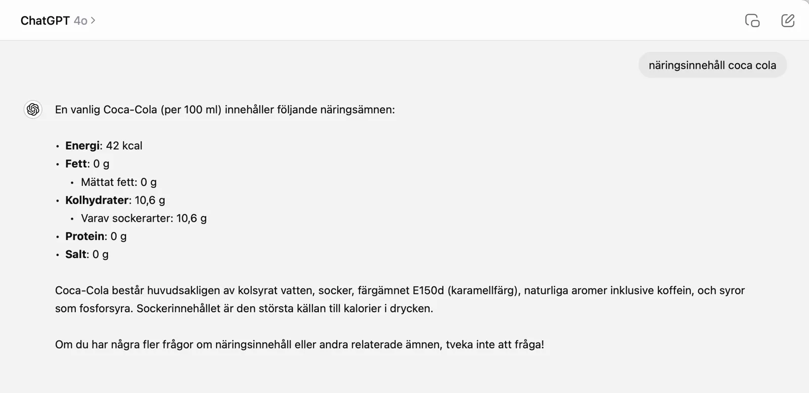
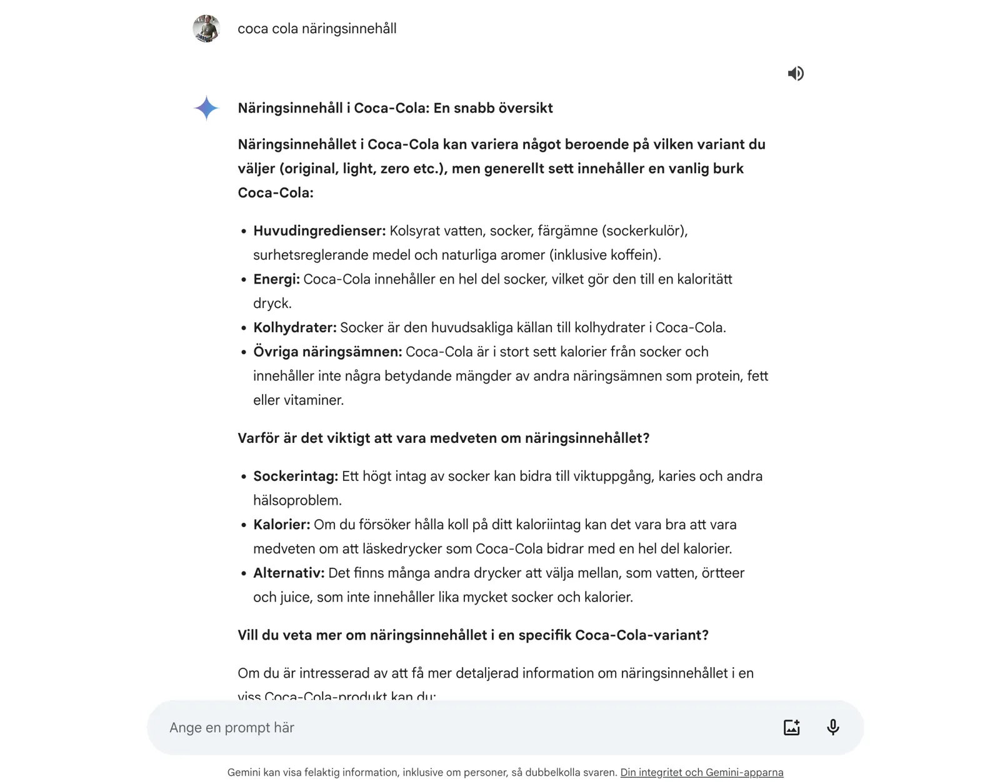
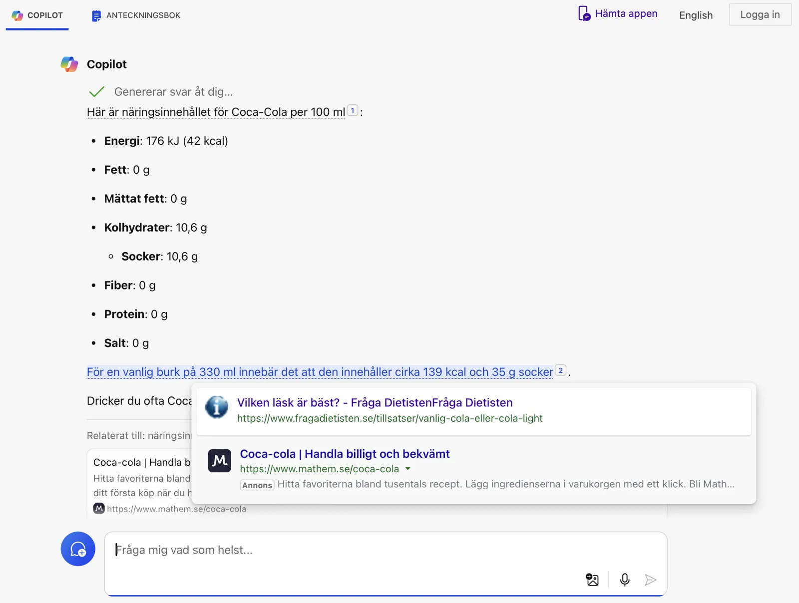

_Den typiska stockbilden på en person som googlar. Foto: [Firmbee.com](https://firmbee.com) från [Unsplash](https://unsplash.com/photos/person-using-black-laptop-computer-eMemmpUojlw?utm_content=creditCopyText&utm_medium=referral&utm_source=unsplash)_

Utvecklingen av AI-modeller, som [ChatGPT](https://openai.com/chatgpt/), [Copilot](https://copilot.microsoft.com/) och [Gemini](https://gemini.google.com/app?hl=sv) utmanar traditionella former av digital marknadsföring och informationssökning. Google har länge varit den dominerande kanalen för annonsörer som vill nå användare med SEO och betalda annonser. Men i takt med att fler användare vänder sig till AI-drivna system för att få snabb och direkt information står annonsörer inför frågan: Hur når vi våra målgrupper i dessa nya gränssnitt?

## Informationssökning via AI: En förändrad dynamik

AI-system som GPT erbjuder snabba och kontextuella svar utan att användaren behöver klicka sig igenom länkar, som är fallet med Googles traditionella sökresultat. [LLM](https://en.wikipedia.org/wiki/Large_language_model)s som ChatGPT missar målet ibland och levererar inte alltid det perfekta svaret. Men det är sannolikt att betrakta som barnsjukdomar. En inte alltför våghalsig gissning är att allt fler kommer att välja [generativ AI](https://sv.wikipedia.org/wiki/Generativ_artificiell_intelligens) som kontaktyta för att söka svar på alla möjliga frågor framför att googla.

Innebär denna förflyttning att företag inte längre kan förlita sig på traditionella SEO-strategier eller betald annonsering för att nå sin publik? Många företag och annonsörer frågar sig sannolikt hur de kan bli en del av den information som AI-modeller genererar. En generativ AI förväntas inte presentera en uppsättning olika källor som användaren kan granska, utan snarare ge ett enda, sammansatt svar. Det är en central utmaning, som gör det svårt för annonsörer att synas på samma sätt som de gör i en sökmotor, där de kan konkurrera om användarens uppmärksamhet genom att betala för en topposition eller optimera sin SEO-strategi.

## Hur optimerar företag för AI-svar?

För att överleva i ett AI-baserat ekosystem behöver företag sannolikt anpassa sitt innehåll för att bli möjliga att upptäcka och använda för AI-system. På ett sätt är det kanske bara en förlängning av SEO, men det kräver förmodligen en mer strukturerad och pålitlig datakälla. Det finns två strategier som jag tror kommer att vara avgörande för dem som kommer att lyckas.

### Auktoritet och trovärdighet

Auktoritet och trovärdighet kommer att vara avgörande. En AI-modell behöver prioritera innehåll som kommer från källor med hög tillförlitlighet, vilket innebär att företag måste etablera sig som ledande aktörer inom sina områden för att AI-modellerna ska hämta information från dem. Innehåll som är tydligt, korrekt och som verifierats av externa auktoriteter kommer att ha större chans att bli integrerat i AI-svaren.

_Skärmavbild ChatGPT 4.0_

ChatGPT ger ett trovärdigt och objektivt intryck i både gränssnittet och svaret på frågan om näringsinnehåll i Coca-Cola.

_Skärmavbild Google Gemini_

Även om Gemini tolkar frågan om näringsinnehåll annorlunda jämfört med ChatGPT, så är det fortfarande relevant, objektivt och trovärdigt.

### Struktur och tillgänglighet

Strukturerat och tillgängligt innehåll är redan centralt på webben, men kommer sannolikt att bli ännu viktigare i framtidens informationssökning. Företag måste leverera innehåll i format som är lätta för AI-modeller att tolka och hämta. Detta kan innebära att se till att data är välorganiserad och att källorna är tydliga och lätta att integrera i de sammansatta kontextuella svar en AI kan ge, till exempel i form av text eller tal.

Men även om företagen lyckas optimera sitt innehåll på dessa sätt, kvarstår ett mer grundläggande problem: Hur kan företag som har investerat mycket i att vara synliga genom betalda annonser i Googles ekosystem överföra denna synlighet till en AI-driven framtid?

## Kommer vi att se sponsrade AI-svar?

En tänkbar utveckling är sponsrade svar, där företag betalar för att deras varumärken eller produkter nämns direkt i AI-genererade svar. Här uppstår såklart flera frågor, både kring transparens och användarupplevelse. Sponsrade svar riskerar att uppfattas som manipulativa om användaren inte tydligt förstår att de får en betald rekommendation snarare än ett neutralt, objektivt svar.

Googles sökmotor har utvecklats från att vara ett neutralt verktyg att söka information på webben, till att mer fungera som ett displayfönster eller en butik för digital konsumtion av varor och tjänster. Det är en naturlig utveckling och inget jag egentligen vill moralisera över eller har synpunkter på. Men det är väl inte alltför radikalt att påstå att Googles sökmotor inte längre är det mest användarvänliga verktyget för att söka fakta och objektiva svar. Den som söker fakta genom att googla behöver ofta lägga ett ganska mödosamt arbete på att navigera runt och förbi en omfattande mängd annonsering och betalda placeringar.

Microsofts AI, Copilot, har i viss mån misslyckats med att separera annonsering och betalda placeringar från själva kärndialogen mellan användaren och språkmodellen. Min tolkning är att designbeslut har tagits av andra affärsmässiga anledningar än att erbjuda den bästa användarupplevelsen. Resultatet blir en mindre personlig och förtroendebyggande interaktion mellan användare och gränssnitt. Möjligtvis finns det en del användare som istället uppskattar den här formen av transparens, där svarets referenser är mer explicita än i exempelvis ChatGPT och Googles Gemini.

_Skärmavbild Microsoft Copilot för Bing_

Som avspeglas i bilden ger Copilot samma svar som ChatGPT på frågan om näringsinnehåll i Coca-Cola. Men svaret omgärdas av betydligt fler säljsignaler och annonsering.

### En fråga om förtroende och transparens

Interaktionen mellan en användare och en AI-baserad LLM är personlig i sin natur, och kan bli närmast intim. Själva finessen är ju att kunna uttrycka sig i tal och skrift på samma sätt som när man för ett samtal med en annan människa. Det finns ett förtroende och ett relationsskapande i den typen av dialog. Kommer då användarna att känna samma förtroende för ett AI-system om de vet att svaren delvis är kommersiellt drivna? Hur påverkas förtroendet och relationen mellan AI-systemet och användaren? Det här är frågor som både teknikföretag och annonsörer kommer att behöva hantera.

Samtidigt finns det säkert möjligheter för företag att bibehålla sin synlighet i gränssnitten för generativ AI. Men de behöver i så fall implementeras på ett transparent och ansvarsfullt sätt. Hur dessa strategier används och utformas kommer sannolikt vara avgörande för användarnas förtroende för AI-systemet i fråga och dess långsiktiga framgång.

## Från traditionell marknadsföring till AI-drivna interaktioner

Ett annat potentiellt svar på dessa utmaningar är att fler företag flyttar sitt fokus från traditionell marknadsföring till mer interaktiva, AI-drivna upplevelser. Här handlar det om att skapa egna AI-system eller chatbots som kan interagera med användarna på ett naturligt sätt, utan att de behöver söka efter information externt.

Genom att erbjuda AI-tjänster som en del av sitt eget ekosystem kan företag skapa en direkt kanal till sina kunder. Detta skulle tillåta dem att hantera hela kundresan från informationssökning till köpbeslut inom en och samma plattform. Det är en strategi som redan tillämpas av vissa stora aktörer inom kundtjänst och e-handel, men potentialen för mer interaktiva AI-upplevelser i andra branscher är sannolikt underutnyttjad.

## Etiska och praktiska utmaningar

Det finns stora etiska och praktiska utmaningar kopplade till AI-baserad marknadsföring. Om företag försöker integrera sina produkter och tjänster alltför aggressivt i AI-genererade svar riskerar de att alienera användare som upplever att deras valmöjligheter begränsas eller manipuleras. Det är en fin balansgång mellan att tillhandahålla relevant, användbar information och att undvika att undergräva användarens autonomi.

Dessutom finns det en risk att kommersialiseringen av AI-svar leder till en upplevelse där användaren inte längre kan skilja mellan objektiva och kommersiella rekommendationer. Detta kan i sin tur påverka hur människor förhåller sig till AI-system överlag och leda till minskat förtroende för tekniken som helhet.

## En uppmaning till försiktighet

För annonsörer och företag som hittills har förlitat sig på Googles sökresultat som en marknadsplats blir framtiden i ett AI-drivet landskap komplex. Det kommer att krävas en noggrann balans mellan att optimera innehåll för AI-modeller, utforska sponsrade AI-svar, och utveckla egna interaktiva lösningar.

Samtidigt måste etiska och användarcentrerade frågor beaktas för att undvika negativa konsekvenser som minskat förtroende och skepsis gentemot AI-system.

Det är tydligt att AI-modeller som GPT representerar ett grundläggande skifte i hur information förmedlas och hur företag interagerar med sina kunder. De som lyckas navigera detta nya landskap med strategisk intelligens och en djup förståelse för användarnas behov kommer sannolikt att ha fördelar i en värld där AI blir en allt viktigare del av informationsflödet.

But hey, I’m no expert 🙂
