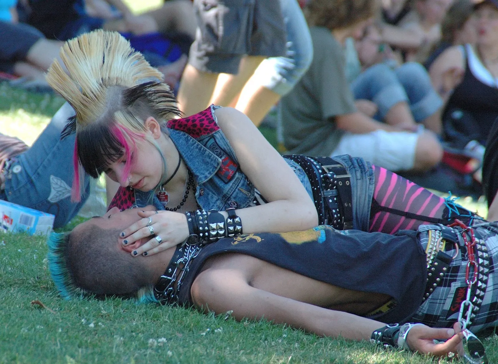
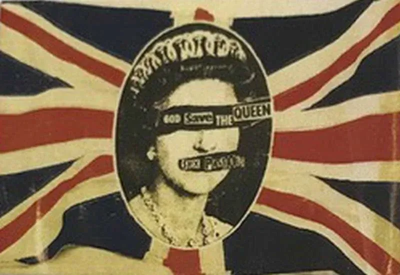
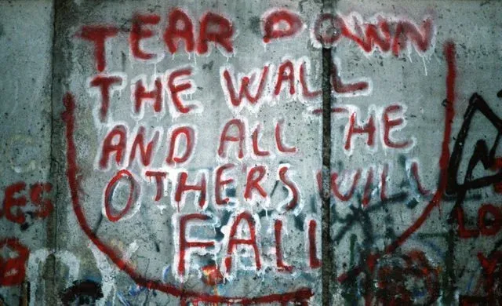
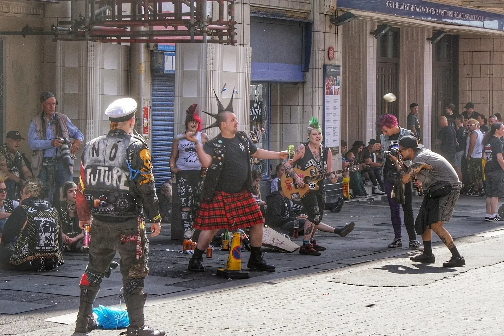

_UX älskar punk. Rättigheter: Patrick, [CC BY 2.0](https://creativecommons.org/licenses/by/2.0), via Wikimedia Commons_

Polerade gränssnitt och sömlösa upplevelser börjar bli en allt större del av det digitala landskapet. UX-design har på många sätt blivit för trygg. Vi värdesätter konsekvens, tillgänglighet och användarvänlighet – värden som är avgörande för att skapa bra produkter. Men är “bra” tillräckligt? Har vi, i jakten på perfektion, tappat förmågan att skapa digitala upplevelser som berör själen? Behöver kanske UX bli lite mer punk? Här är spellistan för ditt nästa designprojekt.

## Problemet med standardiserad UX

Mainstream UX handlar om att minimera friktion, minska kognitiv belastning och göra saker enklare för användarna. Men har vi, genom att slipa bort varje kant, tappat det som verkligen får upplevelser att beröra? Börjar vi fastna i en loop där allt ser likadant ut, där användarna vandrar [mållöst genom en steril värld](https://open.spotify.com/track/5ypZNeAHLND9MZgdVfVMJM?si=e5a03f8b01bb4b73) 🎵, regisserad av ux i hemlighet. I vårt försök att strömlinjeforma designen har vi bytt ut råhet och kaos mot förutsägbarhet — mot något som är ganska tomt.

Platt design, minimalistisk estetik och förutsägbara flöden kan vara effektiva, men de riskerar att dö av sin egen konformitet. Vi är så fokuserade på att minska friktion att vi har glömt vad det betyder att få användare att känna något – en koppling, spänning eller till och med obehag. Men kanske är det precis det som behövs? Kanske måste ett gränssnitt ibland våga säga “[ge fan i mig 🎵](https://music.youtube.com/watch?v=tmRpxkEgQ24&si=t2L0_KQbUWQy8YBK)”, bara för att väcka folk?

## Vad kan punk tillföra UX?

_Sex Pistols vägrade 70-talets konformitet. Rättigheter: [Westfalen digital museum](https://westfalen.museum-digital.de/singleimage?imagenr=8767)._

Punk handlade aldrig om att följa strömmen. Det handlade om uppror, att bryta reglerna och vägra anpassa sig. Under mitten av 1970-talet uppstod punk som en reaktion mot den uppblåsta, överproducerade rockmusiken. Band som Ramones, Sex Pistols och The Clash skalade ner ljudet till dess råa essens – snabbt, högt och enkelt – och kombinerade det med texter som kritiserade samhället, politik och auktoriteter.

Punk var inte bara en musikrörelse; det var en attityd som omfattade gör-det-själv-kultur, anti-etablissemang och en stark vilja till personlig och kreativ frihet. Rörelsen spred sig snabbt över både Storbritannien och USA, och påverkade inte bara musik utan också mode, konst och hur människor såg på världen.

Inom UX har vi följt samma mönster ganska länge. Vad händer om vi river sönder etablerade mönster i den digitala [verkligheten](https://music.youtube.com/watch?v=mNXOfyu_cl0&si=kRLKxT3VxDkTXkhy) 🎵 och omfamnar kaoset? Vad händer om vi utmanar användarna och får dem att tänka, istället för att bara mata dem med samma upplevelser som tidigare?

### Att bryta standarden

Punk handlade om att bryta konventioner. Inom UX betyder det att vi inte alltid måste göra allt enkelt. Användarna vill kanske inte alltid bli ledda genom en upplevelse som i [en perfekt digital värld](https://music.youtube.com/watch?v=Yw0hEs1WCTY&si=uo-mlpg9cavMbQSL) 🎵? Ibland vill de räkna ut saker själva, bli överraskade eller till och med utmanade. Varför ska varje knapp vara perfekt placerad? Kanske borde vi som designers våga ta fler risker och låta användarna leva ut sina egna personligheter och preferenser i relation till de gränssnitt vi skapar? Föreställ dig till exempel en digital tjänst med hög integritet, som ganska motsträvigt bjuder in sina användare – vilka reaktioner skulle det skapa?

### Att omfamna ofullkomlighet

Punk var rått och rörigt. Det brydde sig inte om att vara perfekt – för mycket perfektion var ett misstag. Inom UX borde vi kunna omfamna den andan. Istället för att vara besatta av sömlösa, polerade gränssnitt, varför inte tillåta lite kaos? Kanske en glitch, ett krockande färgschema eller en oväntad interaktion skulle göra upplevelsen mer autentisk? Det överpolerade saknar känslor. Det måste finnas något verkligt, något som berör!

### Att ge makten till användarna

Punk handlade om att ge makten till folket, att låta dem bryta sig loss från all kontroll. UX borde ta efter detta. Istället för att låsa användarna till ett smalt urval av valmöjligheter, ge dem verktygen att forma sin egen upplevelse. Låt dem ta sönder saker, hacka dem och sätta ihop dem igen. Som användare vill jag vara mig själv. Varför tvinga användarna att följa samma stigar när de kan skapa sina egna?

## Punk i praktiken: kreativ dissonans i UX

Det fanns en tid då digitala utrymmen kändes råa, kaotiska – och levande. Det var innan allt mer av det digitala samhället började kräva [vårdad klädsel 🎵](https://music.youtube.com/watch?v=vdLaPM10O6M&si=m4fydmO980XVdmGL). Plattformar som Myspace och GeoCities lät användare skapa sina egna röriga hörn av internet. De var inte designade med elegant perfektion i åtanke, men de var autentiska, ofiltrerade och fulla av personlighet. Denna kaotiska frihet var ett uttryck för äkta individualitet, inte bunden av mallar eller strikta riktlinjer.

Spel som Roblox och Minecraft fångar något av den här gör-det-själv-attityden. Deras gränssnitt är inte överdrivet raffinerade eller välslipade, och det känns som en plats där användare kan bygga sina egna gemenskaper – där användaren kan forma plattformen efter sina behov istället för att följa någon annans rigida designregler. Det är lite kantigt och klonkigt, men det är kanske också det som gör det speciellt. Ett gränssnitt kan vara en plats där användare kan skapa sin egen identitet och gå sin egen väg.

Och sedan finns det anti-design, där designers medvetet bryter mot de konventionella estetiska reglerna. Obalanserade layouter, skarpa övergångar och överraskande, oförfinade visuella element utmanar idén om att design måste vara perfekt för att vara effektiv. I denna värld är ofullkomligheter inte misslyckanden — de är medvetna beslut.

## Den etiska punkaren: en meningsfull protest

_Berlinmuren 1989. Rättigheter: [SSGT F. Lee Cockran, The U.S. National Archives](https://nara.getarchive.net/media/graffiti-on-the-west-side-of-the-berlin-wall-expresses-the-desire-for-a-unified-f91dd4)._

Punk handlade inte bara om kaos – det handlade om att använda det kaoset för att konfrontera samhällsnormer och korruption. Inom UX borde vi ibland våga anta en liknande inställning. Protest behöver ett syfte. Det handlar inte om att ändra saker för sakens skull – det handlar om att skapa design som utmanar oetiska mönster i den digitala världen. UX borde ta ställning mot interaktionsmönster som hindrar användarnas frihet eller vilseleder dem, precis som punk kämpade mot samhällskontroll. Det behövs ibland en högljudd protest mot allmän acceptans av vad det digitala landskapet har formats till och är idag.

När vi [river alla murar](https://music.youtube.com/watch?v=VNYpqODTB60&si=Ko1zlaf3aCORvBDc) 🎵 och invanda interaktionsmönster bör vi stärka användarna och ge dem verktygen att navigera systemen på sina egna villkor. Det handlar om att ifrågasätta, pusha tillbaka och stå emot frestelsen att designa enbart för vinst. Låt oss inte falla i fällan att designa för kontroll. Alla användare vill inte bli tillsagda vad de vill ha eller vad de behöver.

## Dags att utmana det som blivit självklart

_Rättigheter: Stephen Gidley, [CC BY 2.0](https://creativecommons.org/licenses/by/2.0), via Wikimedia Commons_

UX behöver mer punk – mer uppror, mer risk, mer råhet. Det är dags för designers att släppa de bekväma Figma-spakarna och lämna tryggheten som (det lånade) designsystemet ger och skapa något som resonerar på en djupare, mänsklig nivå. Punk lär oss att det inte bara går att bryta regler ibland – utan att det är just det som kan skapa en verklig anknytning till den digitala upplevelsen. Så var inte rädd att ta ett kliv bort från fårskocken och prova några grepp som inte alls följer etablerade mönster och normer. [Tänk negativt! 🎵](https://music.youtube.com/watch?v=RX__98qQg4k&si=uDHllpjdSYq9DuNZ), även om det nog kan kännas läskigt, så finns kanske just det där som gör hela skillnaden utanför den upptrampade stigen.

Det är dags att omvärdera UX – inte bara som en maskin för att skapa smidiga, friktionsfria upplevelser, utan också som en plattform för experiment, uppror och verkliga användarupplevelser.

## Referenser

- [Mental istid – av Ebba Grön](https://open.spotify.com/track/5ypZNeAHLND9MZgdVfVMJM?si=e5a03f8b01bb4b73)
- [Ge fan i mig – av Attentat](https://music.youtube.com/watch?v=tmRpxkEgQ24&si=t2L0_KQbUWQy8YBK)
- [Verkligheten – av Radioaktiva Räker](https://music.youtube.com/watch?v=mNXOfyu_cl0&si=kRLKxT3VxDkTXkhy)
- [I en perfekt värld – av Charta 77](https://music.youtube.com/watch?v=Yw0hEs1WCTY&si=uo-mlpg9cavMbQSL)
- [Vårdad klädsel – av Kriminella gitarrer](https://music.youtube.com/watch?v=vdLaPM10O6M&si=m4fydmO980XVdmGL)
- [Riv alla murar – av Rolands Gosskör](https://music.youtube.com/watch?v=VNYpqODTB60&si=Ko1zlaf3aCORvBDc)
- [Tänk negativt – av Attentat](https://music.youtube.com/watch?v=RX__98qQg4k&si=uDHllpjdSYq9DuNZ)
