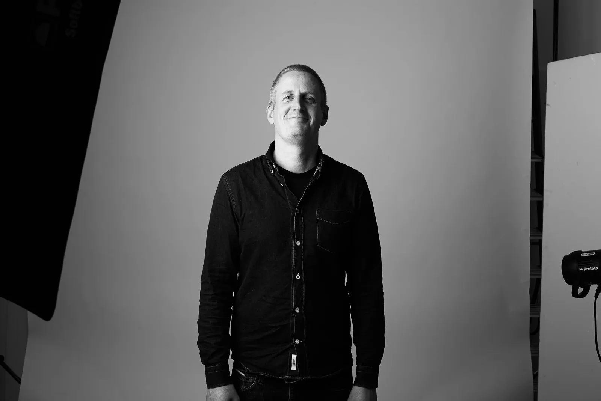

**Tractory AB drivs av Jonas Engkvist, tjänstedesigner i Stockholm.** Jag har arbetat med tjänstedesign och UX sedan 2007 och hjälper företag och offentlig sektor att förstå och förbättra sina tjänster, utifrån hur människor faktiskt använder dem.

## Bakgrund

Jag har en akademisk bakgrund inom kognitionsvetenskap, psykologi, sociologi och pedagogik, med över åtta års universitetsstudier. Det gör att jag ser både individen och det sociala sammanhanget runt en tjänst. Jag har arbetat med allt från lärandeupplevelser till webbplatser och digitala tjänster i de flesta branscher.

Tractory är också en del av designbyrån [One Day Interact](https://onedayinteract.se/), som har ett bredare utbud inom digital design.

## Digital etik

Jag är initiativtagare till [Digital Design Ethics](https://www.digitaldesignethics.com/), tio principer för etisk digital design skrivna som användarhistorier. De är fria att använda i alla designprojekt. Etik är för mig en del av hantverket: design ska vara inkluderande, respektera människors integritet och bidra positivt till samhället.

## Texter och perspektiv

Jag skriver om UX research, tjänstedesign, digital etik och det digitala samhället, på svenska här på sajten och på engelska på [Medium](https://medium.com/@jonasengkvist). Flera texter har publicerats i UX Collective, bland annat:

- [UX behöver mer punk!](/blogg/ux-behver-mer-punk)
- [Varför finns det inte fler UX-sociologer?](/blogg/varfr-finns-det-inte-fler-ux-sociologer)
- [10 etiska principer för digitala tjänster](/blogg/10-etiska-principer-for-digitala-tjanster)

## Hur jag arbetar

Tjänstedesign är kärnan, med UX research som grund för besluten. Jag kombinerar kvalitativa och kvantitativa metoder och lägger stor vikt vid att data håller. Det ska också vara kul att jobba: att vara professionell och seriös är ingen motsats till att skratta och le.

<a class="knapp" href="/kontakt">Boka ett samtal</a>
<a class="knapp kontur" href="https://www.linkedin.com/in/jonas-engkvist/">LinkedIn</a>
<a class="knapp kontur" href="https://medium.com/@jonasengkvist">Medium</a>
